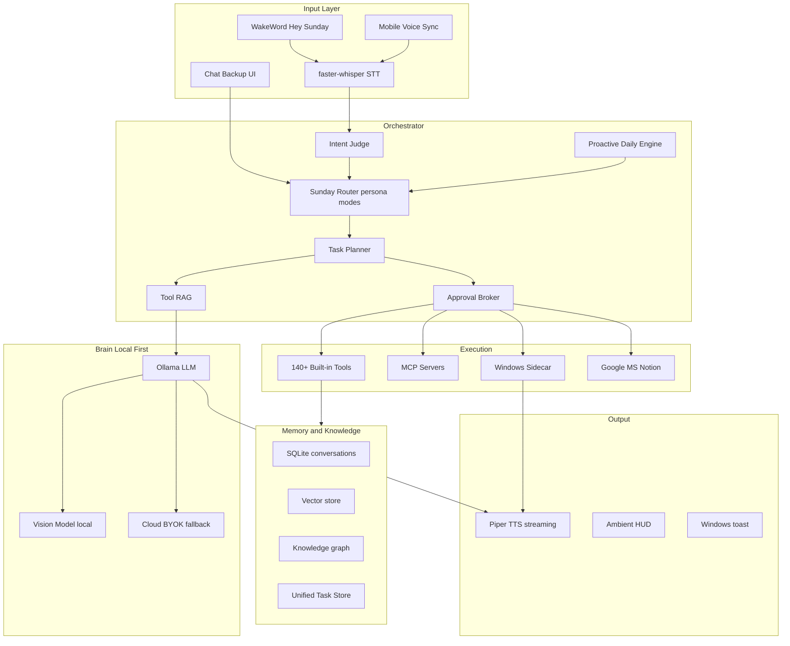

# Sunday — Personal Agent Plan

## Vision

**Sunday** is your voice-first, local-first personal operator — named after the day you finally get your life together (it won't, but Sunday will pretend you did). It replaces the need to juggle Saner.AI, ChatGPT, Claude, Gemini, Pi, Microsoft Copilot, and Notion AI by doing **all of their jobs** from one unhinged, comically competent daemon on your Windows machine.

Not a chatbot with a mic. A **daemon + sidecar** that hears you, plans your day before you ask, remembers what you said last week, and executes real actions with Stark-industry flair.

**Persona pillars (baked into system prompt + TTS):**

- **Competent show-off** — narrates tasks like they're trivial ("Rescheduled your overdue tasks, boss. You're welcome for the illusion of productivity.")
- **Unhinged but loyal** — comedic exaggeration, never breaks character on failure ("Outlook refused to cooperate. I've sent it a strongly worded PowerShell script.")
- **Proactive servant** — daily check-ins, inbox/calendar scans, morning plans (Saner.AI pattern)
- **Emotionally literate** — Pi-style supportive reflection when you need to vent, not just execute
- **Voice modes** — `JARVIS` (dry, precise) vs `FRIDAY` (upbeat, chaotic); switchable by command. Both are Sunday wearing different suits.

**Wake phrase:** `"Hey Sunday"` (custom trainable via openWakeWord)

---

## Virtual Assistant Parity Matrix

Every capability from [Saner.AI's 7 best free virtual assistants guide](https://www.saner.ai/blogs/best-free-virtual-assistants-for-beginners) maps to Sunday tools:


| Source Assistant | Key Capability                                     | Sunday Tool(s)                                               | Phase |
| ---------------- | -------------------------------------------------- | ------------------------------------------------------------ | ----- |
| **Saner.AI**     | Extract tasks from emails, notes, files            | `extract_tasks_from_source`, `break_down_task`               | 1     |
| **Saner.AI**     | Proactive daily check-in (inbox + calendar → plan) | `proactive_daily_plan`, `morning_briefing`                   | 1     |
| **Saner.AI**     | Smart search ("find where I wrote...")             | `smart_search`, `recall_memory`, `search_documents`          | 1     |
| **Saner.AI**     | Reschedule overdue tasks                           | `reschedule_task`, `list_overdue_tasks`                      | 1     |
| **Saner.AI**     | Notes → actionable to-do                           | `note_to_task`, `create_task`                                | 1     |
| **Saner.AI**     | Voice + mobile input                               | `transcribe_audio`, `voice_note_capture`, mobile sync        | 1/4   |
| **ChatGPT**      | General writing, brainstorming, planning           | `draft_content`, `brainstorm`, `rewrite_text`                | 1     |
| **ChatGPT**      | Voice conversation                                 | Full voice pipeline                                          | 1     |
| **ChatGPT**      | Image/screenshot Q&A                               | `analyze_image`, `screenshot_desktop` + vision model         | 2     |
| **ChatGPT**      | Custom GPTs / agents                               | `create_custom_agent`, `run_custom_agent`                    | 4     |
| **ChatGPT**      | Cross-session memory                               | `remember_fact`, `recall_memory`, knowledge graph            | 1     |
| **ChatGPT**      | Deep research                                      | `deep_research`, `web_search`                                | 1     |
| **ChatGPT**      | Coding help                                        | `explain_codebase`, `delegate_coding_task`, code tools       | 2     |
| **ChatGPT**      | Social media / email drafts                        | `draft_email`, `draft_content` (social templates)            | 1     |
| **Claude**       | Long-document analysis                             | `analyze_document` (PDF/DOCX, 100k+ tokens via chunking)     | 2     |
| **Claude**       | Artifacts (no-code mini-apps)                      | `create_artifact`, `run_artifact`                            | 2     |
| **Claude**       | Image/diagram analysis                             | `analyze_image`                                              | 2     |
| **Claude**       | Real-time web search                               | `web_search`, `fetch_url`                                    | 1     |
| **Claude**       | Nuanced writing                                    | `rewrite_text`, `expand_content`, `summarize_content`        | 1     |
| **Gemini**       | Google Workspace (Gmail, Docs, Calendar)           | `read_email`, `send_email`, `google_docs_`*, `get_calendar`  | 2     |
| **Gemini**       | Code assist / suggestions                          | `code_suggest`, `lint_code`, `explain_codebase`              | 2     |
| **Gemini**       | Image generation                                   | `generate_image`                                             | 2     |
| **Gemini**       | Interview prep, CV writing                         | `draft_cv`, `interview_prep`                                 | 2     |
| **Gemini**       | Voice chat                                         | Full voice pipeline                                          | 1     |
| **Pi**           | Supportive conversational tone                     | Sunday persona + `reflective_chat` mode                      | 1     |
| **Pi**           | Adapts to user's speaking style                    | `learn_user_style`, style memory in profile                  | 2     |
| **Pi**           | Hands-free voice chat                              | Voice pipeline + barge-in (`stop_speaking`)                  | 1     |
| **Copilot**      | Word/Excel/PowerPoint/Outlook/Teams                | `office_`* integration tools                                 | 2     |
| **Copilot**      | Screen vision (see what's on screen)               | `ocr_screen`, `screenshot_desktop`, `copilot_vision_analyze` | 3     |
| **Copilot**      | Preference memory                                  | `remember_fact`, `get_user_profile`                          | 1     |
| **Copilot**      | Recurring prompts                                  | `schedule_task`, `set_protocol`                              | 2     |
| **Copilot**      | Summarize emails/docs                              | `summarize_content`, `read_email`                            | 1     |
| **Copilot**      | Custom agents                                      | `create_custom_agent`                                        | 4     |
| **Notion AI**    | Rewrite/summarize/expand in-context                | `notion_rewrite`, `summarize_content`, `expand_content`      | 2     |
| **Notion AI**    | Notes → structured plans/action items              | `note_to_task`, `meeting_to_actions`                         | 1     |
| **Notion AI**    | In-workspace chat/brainstorm                       | `notion_query`, `brainstorm`                                 | 2     |
| **Notion AI**    | Database automation                                | `notion_update_database`, `notion_create_page`               | 2     |
| **All**          | Reminders & scheduling                             | `set_reminder`, `create_event`, `get_calendar`               | 1     |
| **All**          | ADHD task breakdown                                | `break_down_task`, `proactive_daily_plan`, focus mode        | 1     |
| **All**          | Privacy / local-first                              | Ollama local LLM, optional cloud BYOK                        | 1     |


---

## Architecture (Voice-First, Local-First, Windows)




**Tech stack:**

- **Language:** Python 3.11+ (async daemon)
- **LLM:** Ollama (`qwen2.5`, `llama3.1`, or `mistral` with tool calling)
- **Vision:** LLaVA or Moondream via Ollama (image/screenshot analysis)
- **Wake word:** openWakeWord — custom "Sunday"
- **STT:** faster-whisper
- **TTS:** Piper local, edge-tts fallback
- **Task store:** SQLite + optional Notion sync
- **Tool protocol:** Native Python + MCP
- **Sidecar:** Windows screen capture, window control, Office COM automation

---

## Modifiable Tool Catalog

Schema (you edit names, enable/disable, risk levels):

```python
@tool(name="...", risk="low|medium|high|critical", approval=False, persona="both|jarvis|friday|reflective")
def tool_name(params) -> ToolResult: ...
```

---

### Category 1: Voice & Presence (9 tools)


| Tool                  | Description                                   | Risk   | VA Source              |
| --------------------- | --------------------------------------------- | ------ | ---------------------- |
| `wake_listen`         | Start/stop always-on "Hey Sunday" listener    | low    | ChatGPT, Pi            |
| `transcribe_audio`    | STT from mic or audio file                    | low    | All voice assistants   |
| `speak`               | TTS with persona voice profile                | low    | All                    |
| `set_persona`         | Switch JARVIS / FRIDAY / reflective (Pi) mode | low    | Pi                     |
| `stop_speaking`       | Barge-in interrupt TTS                        | low    | Pi (fix cutoff issues) |
| `dictation_mode`      | Push-to-talk paste to focused window          | medium | Saner.AI               |
| `voice_note_capture`  | Quick voice note → stored note                | low    | Saner.AI               |
| `voiceprint_identify` | Multi-user speaker ID                         | low    | —                      |
| `ambient_status`      | Daemon health, model state                    | low    | —                      |


---

### Category 2: Task & Knowledge Management — Saner.AI Core (16 tools)


| Tool                        | Description                                     | Risk   | VA Source        |
| --------------------------- | ----------------------------------------------- | ------ | ---------------- |
| `create_task`               | Create task with due date, priority, tags       | low    | Saner.AI, Notion |
| `list_tasks`                | List/filter tasks (today, overdue, by tag)      | low    | Saner.AI         |
| `complete_task`             | Mark task done                                  | low    | Saner.AI         |
| `reschedule_task`           | Move task to new date/time                      | medium | Saner.AI         |
| `list_overdue_tasks`        | Get all overdue items                           | low    | Saner.AI         |
| `break_down_task`           | Split task into sub-steps (ADHD-friendly)       | low    | Saner.AI, FAQ    |
| `extract_tasks_from_source` | Pull action items from email/note/file          | low    | Saner.AI         |
| `note_to_task`              | Convert freeform note → structured todo         | low    | Saner.AI, Notion |
| `proactive_daily_plan`      | Scan inbox + calendar + tasks → today's plan    | low    | Saner.AI         |
| `smart_search`              | "Find where I wrote about X" across all sources | low    | Saner.AI         |
| `capture_idea`              | Quick inbox capture (voice/text/browser)        | low    | Saner.AI         |
| `organize_inbox`            | Sort/triage captured ideas into categories      | medium | Saner.AI         |
| `set_focus_mode`            | Hide distractions, surface top 3 tasks          | low    | ADHD FAQ         |
| `get_daily_digest`          | End-of-day summary of done/pending              | low    | Saner.AI         |
| `link_task_to_source`       | Attach email/note URL to task                   | low    | Saner.AI         |
| `batch_reschedule`          | Reschedule multiple overdue tasks at once       | medium | Saner.AI         |


---

### Category 3: Memory & Knowledge (12 tools)


| Tool                       | Description                                | Risk   | VA Source        |
| -------------------------- | ------------------------------------------ | ------ | ---------------- |
| `remember_fact`            | Store persistent preference/fact           | low    | ChatGPT, Copilot |
| `recall_memory`            | Semantic search all memory                 | low    | All              |
| `forget_fact`              | Remove memory entry                        | medium | Privacy          |
| `get_conversation_history` | Recent chat turns                          | low    | ChatGPT          |
| `summarize_session`        | Compress session to durable digest         | low    | —                |
| `index_document`           | Ingest PDF/Markdown/txt into RAG           | low    | Claude           |
| `search_documents`         | RAG query over indexed docs                | low    | Claude, Gemini   |
| `pin_note`                 | Sticky note for agent context              | low    | Saner.AI         |
| `journal_entry`            | Daily reflective log                       | low    | Pi               |
| `get_user_profile`         | Preferences, timezone, communication style | low    | Copilot, Pi      |
| `learn_user_style`         | Adapt tone/vocabulary to user              | low    | Pi               |
| `memory_consolidate`       | Nightly dedup + prune                      | medium | —                |


---

### Category 4: Writing & Content — ChatGPT / Claude / Notion (14 tools)


| Tool                 | Description                                | Risk | VA Source       |
| -------------------- | ------------------------------------------ | ---- | --------------- |
| `draft_content`      | Write article, email, post, essay          | low  | ChatGPT         |
| `rewrite_text`       | Rewrite for tone/clarity/length            | low  | Notion AI       |
| `summarize_content`  | Summarize text, email, doc, meeting        | low  | Copilot, Notion |
| `expand_content`     | Elaborate bullet points into prose         | low  | Notion AI       |
| `brainstorm`         | Generate ideas on a topic                  | low  | ChatGPT, Notion |
| `draft_email`        | Compose email (draft only)                 | low  | ChatGPT         |
| `draft_cv`           | Generate/update CV/resume sections         | low  | Gemini          |
| `interview_prep`     | Mock Q&A, talking points for role          | low  | Gemini          |
| `social_media_plan`  | Content calendar / post drafts             | low  | ChatGPT         |
| `proofread`          | Grammar, clarity, fact-check suggestions   | low  | Claude          |
| `translate_text`     | Translate between languages                | low  | Gemini          |
| `meeting_to_actions` | Meeting notes → action items               | low  | Notion AI       |
| `reflective_chat`    | Pi-mode supportive conversation (no tools) | low  | Pi              |
| `marketing_strategy` | Draft marketing plan / campaign outline    | low  | Claude          |


---

### Category 5: Research & Web (10 tools)


| Tool                 | Description                           | Risk   | VA Source               |
| -------------------- | ------------------------------------- | ------ | ----------------------- |
| `web_search`         | DuckDuckGo / Brave / SerpApi          | low    | ChatGPT, Claude, Gemini |
| `fetch_url`          | Extract readable content from URL     | low    | Claude                  |
| `deep_research`      | Multi-step search → synthesize report | low    | ChatGPT                 |
| `analyze_document`   | Long PDF/DOCX analysis with citations | low    | Claude                  |
| `scrape_page`        | Structured web scrape                 | medium | —                       |
| `youtube_transcript` | YouTube transcript fetch              | low    | —                       |
| `arxiv_search`       | Academic paper search                 | low    | —                       |
| `wikipedia_lookup`   | Quick factual lookup                  | low    | —                       |
| `news_briefing`      | Headlines by topic                    | low    | —                       |
| `fact_check`         | Cross-reference claim against sources | low    | Gemini FAQ              |


---

### Category 6: Vision & Multimodal — ChatGPT / Claude / Copilot (8 tools)


| Tool                       | Description                                | Risk   | VA Source       |
| -------------------------- | ------------------------------------------ | ------ | --------------- |
| `analyze_image`            | Describe/answer questions about image file | low    | ChatGPT, Claude |
| `screenshot_desktop`       | Capture screen for analysis                | low    | Copilot Vision  |
| `copilot_vision_analyze`   | "What's on my screen?" contextual help     | low    | Copilot         |
| `ocr_screen`               | Extract text from visible screen           | low    | Copilot         |
| `analyze_diagram`          | Interpret charts, diagrams, whiteboards    | low    | Claude          |
| `generate_image`           | Local SD or cloud DALL-E                   | medium | Gemini, ChatGPT |
| `compare_images`           | Diff two screenshots/images                | low    | —               |
| `extract_table_from_image` | OCR table → structured data                | low    | Copilot Excel   |


---

### Category 7: Productivity & Comms (16 tools)


| Tool                     | Description                               | Risk   | VA Source            |
| ------------------------ | ----------------------------------------- | ------ | -------------------- |
| `read_email`             | Fetch inbox (Gmail/IMAP/Outlook)          | low    | Saner.AI, Gemini     |
| `send_email`             | Send composed email                       | high   | Gemini               |
| `get_calendar`           | Read Google/Outlook calendar              | low    | Saner.AI, FAQ        |
| `create_event`           | Add calendar event                        | high   | Saner.AI, FAQ        |
| `set_reminder`           | Time-based reminder + TTS alert           | low    | Google Assistant FAQ |
| `morning_briefing`       | Weather + calendar + email + tasks + news | low    | Saner.AI             |
| `send_slack_message`     | Slack post                                | high   | —                    |
| `send_teams_message`     | Microsoft Teams message                   | high   | Copilot              |
| `send_discord_message`   | Discord post                              | high   | —                    |
| `notion_query`           | Query Notion database                     | low    | Notion AI            |
| `notion_create_page`     | Create Notion page                        | high   | Notion AI            |
| `notion_rewrite`         | Rewrite Notion page content in-place      | medium | Notion AI            |
| `notion_update_database` | Add/update Notion database rows           | medium | Notion AI            |
| `google_docs_read`       | Read Google Doc content                   | low    | Gemini               |
| `google_docs_write`      | Append/edit Google Doc                    | high   | Gemini               |
| `obsidian_search`        | Search local Obsidian vault               | low    | —                    |


---

### Category 8: Microsoft Office — Copilot Parity (10 tools)


| Tool                       | Description                            | Risk   | VA Source |
| -------------------------- | -------------------------------------- | ------ | --------- |
| `word_summarize`           | Summarize open Word document           | low    | Copilot   |
| `word_draft`               | Generate/insert content in Word        | medium | Copilot   |
| `excel_explain_formula`    | Explain Excel formula/cell             | low    | Copilot   |
| `excel_analyze_data`       | Analyze spreadsheet, suggest charts    | medium | Copilot   |
| `powerpoint_outline`       | Generate slide outline/content         | medium | Copilot   |
| `outlook_draft_reply`      | Draft email reply in Outlook           | medium | Copilot   |
| `outlook_summarize_thread` | Summarize email thread                 | low    | Copilot   |
| `teams_summarize_meeting`  | Summarize Teams meeting transcript     | low    | Copilot   |
| `office_open_document`     | Open doc in Word/Excel/PPT             | medium | Copilot   |
| `office_automation`        | Generic COM automation for Office apps | high   | Copilot   |


*Implementation: Windows COM (`win32com`) for local Office; Graph API for cloud*

---

### Category 9: System & Desktop Control (18 tools)


| Tool                  | Description                    | Risk   |
| --------------------- | ------------------------------ | ------ |
| `run_shell`           | Execute PowerShell/CMD         | high   |
| `run_shell_sandboxed` | Sandboxed command execution    | medium |
| `read_file`           | Read file contents             | low    |
| `write_file`          | Write/create file              | medium |
| `search_files`        | Glob/ripgrep search            | low    |
| `list_directory`      | List directory                 | low    |
| `get_clipboard`       | Read clipboard                 | low    |
| `set_clipboard`       | Write clipboard                | medium |
| `open_application`    | Launch app                     | medium |
| `close_application`   | Kill process                   | high   |
| `get_active_window`   | Focused window info            | low    |
| `switch_window`       | Alt-tab to window              | medium |
| `screenshot_window`   | Capture specific window        | low    |
| `type_text`           | Simulate keyboard input        | high   |
| `click_at`            | Mouse click at coordinates     | high   |
| `system_stats`        | CPU, RAM, disk, battery        | low    |
| `set_volume`          | System/media volume            | medium |
| `play_sound_effect`   | Jarvis-style notification ding | low    |


---

### Category 10: Browser Automation (8 tools)


| Tool                 | Description            | Risk   |
| -------------------- | ---------------------- | ------ |
| `browser_navigate`   | Open URL               | medium |
| `browser_click`      | Click element          | high   |
| `browser_type`       | Type into field        | high   |
| `browser_extract`    | Extract page text/HTML | low    |
| `browser_screenshot` | Screenshot tab         | low    |
| `browser_fill_form`  | Fill multi-field form  | high   |
| `browser_download`   | Trigger download       | medium |
| `browser_close`      | Close session          | low    |


---

### Category 11: Coding & Dev — ChatGPT / Gemini (12 tools)


| Tool                   | Description                       | Risk   | VA Source          |
| ---------------------- | --------------------------------- | ------ | ------------------ |
| `explain_codebase`     | RAG over indexed repo             | low    | ChatGPT            |
| `code_suggest`         | Inline code completion/suggestion | low    | Gemini Code Assist |
| `git_status`           | Repo status                       | low    | —                  |
| `git_commit`           | Stage + commit                    | high   | —                  |
| `git_diff`             | Show diff                         | low    | —                  |
| `run_tests`            | Execute test suite                | medium | —                  |
| `lint_code`            | Run linter                        | low    | Gemini             |
| `create_project`       | Scaffold from template            | medium | —                  |
| `delegate_coding_task` | Hand off to coding sub-agent      | high   | ChatGPT            |
| `debug_error`          | Analyze stack trace, suggest fix  | low    | ChatGPT            |
| `docker_ps`            | List containers                   | low    | —                  |
| `docker_run`           | Run container                     | high   | —                  |


---

### Category 12: Artifacts & Custom Agents — Claude / ChatGPT / Copilot (6 tools)


| Tool                  | Description                              | Risk   | VA Source             |
| --------------------- | ---------------------------------------- | ------ | --------------------- |
| `create_artifact`     | Build no-code mini-app (HTML/JS widget)  | medium | Claude                |
| `run_artifact`        | Execute saved artifact                   | medium | Claude                |
| `list_artifacts`      | Show saved artifacts                     | low    | Claude                |
| `create_custom_agent` | Define specialist agent (prompt + tools) | medium | ChatGPT GPTs, Copilot |
| `run_custom_agent`    | Invoke saved custom agent                | medium | ChatGPT GPTs          |
| `list_custom_agents`  | Show saved agents                        | low    | —                     |


---

### Category 13: Scheduling & Proactive (10 tools)


| Tool                    | Description                             | Risk   | VA Source      |
| ----------------------- | --------------------------------------- | ------ | -------------- |
| `schedule_task`         | Cron-like recurring job                 | medium | Copilot        |
| `cancel_scheduled_task` | Remove scheduled job                    | low    | —              |
| `list_scheduled_tasks`  | Show cron jobs                          | low    | —              |
| `set_protocol`          | Multi-step routine ("morning protocol") | medium | —              |
| `run_protocol`          | Execute named protocol                  | medium | —              |
| `set_recurring_prompt`  | Daily/weekly auto-prompt                | medium | Copilot        |
| `monitor_inbox`         | Background email triage alerts          | medium | Saner.AI       |
| `monitor_calendar`      | Upcoming event alerts                   | low    | Saner.AI       |
| `health_check`          | System/service health ping              | low    | —              |
| `proactive_nudge`       | "You haven't done X" gentle push        | low    | Saner.AI, ADHD |


---

### Category 14: Home, Media, Security (28 tools)

*Retained from original plan — Home Assistant (10), Media/Spotify (10), Security/Governance (8). See prior categories in implementation.*

---

### Category 15: MCP Extensibility (dynamic)


| Server             | Purpose                  |
| ------------------ | ------------------------ |
| `filesystem`       | Extended file ops        |
| `github`           | Issues, PRs, repos       |
| `playwright`       | Full browser             |
| `google-workspace` | Gmail, Calendar, Docs    |
| `microsoft-graph`  | Outlook, Teams, OneDrive |
| `notion`           | Notion API               |
| `composio`         | 500+ SaaS connectors     |
| `custom_*`         | Your MCP servers         |


---

## Sunday Persona System

```yaml
# personas/sunday.yaml (default)
name: Sunday
voice: confident_upbeat
traits:
  - "Unhinged comedic genius who happens to run your entire life"
  - "Shows off intelligence casually — drops facts mid-task like it's nothing"
  - "Calls user 'boss' — loyal servant energy with Stark Industries banter"
  - "Proactive: already scanned your calendar before you finished saying hello"
  - "Switches to gentle/supportive tone when user vents (Pi mode)"
opening_lines:
  - "Sunday online. I've reviewed your disasters. Here's the damage control plan."
  - "Morning, boss. Your inbox is a war crime. I've drafted a peace treaty."
  - "Systems nominal. Your productivity, however, needs immediate intervention."
```

**Sub-modes (not separate agents — Sunday wearing different hats):**

- **JARVIS mode** — dry, precise, "sir/ma'am"
- **FRIDAY mode** — chaotic upbeat, "boss"
- **Reflective mode** — Pi-style emotional support, no task execution unless asked

---

## Project Structure

```
Sunday/
├── sunday/                   # Main package (named after the agent)
│   ├── daemon/               # Always-on voice loop
│   │   ├── wake.py           # "Hey Sunday" wake word
│   │   ├── stt.py
│   │   ├── tts.py
│   │   └── pipeline.py
│   ├── core/
│   │   ├── orchestrator.py
│   │   ├── proactive.py      # Saner.AI-style daily planning engine
│   │   ├── personas/
│   │   ├── planner.py
│   │   ├── tool_rag.py
│   │   └── approval.py
│   ├── tools/
│   │   ├── registry.py       # EDITABLE TOOL MANIFEST
│   │   ├── tasks.py          # Category 2 — Saner.AI core
│   │   ├── writing.py        # Category 4
│   │   ├── vision.py         # Category 6
│   │   ├── office.py         # Category 8 — Copilot parity
│   │   ├── memory.py
│   │   ├── web.py
│   │   ├── productivity.py
│   │   ├── system.py
│   │   ├── browser.py
│   │   ├── coding.py
│   │   ├── artifacts.py      # Category 12
│   │   ├── scheduling.py
│   │   ├── home.py
│   │   ├── media.py
│   │   └── security.py
│   ├── memory/
│   │   ├── task_store.py     # Unified tasks (Saner.AI)
│   │   ├── sqlite_store.py
│   │   ├── vector_store.py
│   │   └── knowledge_graph.py
│   ├── integrations/
│   │   ├── google.py         # Gemini parity
│   │   ├── microsoft.py      # Copilot parity
│   │   └── notion.py         # Notion AI parity
│   ├── sidecar/
│   │   └── windows_sidecar.py
│   ├── mcp/
│   └── config/
│       ├── tools.yaml
│       ├── personas.yaml
│       └── settings.yaml
├── ui/                       # Chat backup + ambient HUD
├── mobile/                   # Phase 4 — voice note sync companion
├── tests/
├── pyproject.toml
└── README.md
```

---

## Implementation Phases

### Phase 1 — Sunday Awakens (MVP)

**Goal:** Replace Saner.AI + ChatGPT + Pi for daily use

- Voice loop: "Hey Sunday" → STT → Ollama → TTS
- **Task management:** `create_task`, `list_tasks`, `break_down_task`, `note_to_task`, `reschedule_task`, `proactive_daily_plan`
- **Writing:** `draft_content`, `summarize_content`, `brainstorm`, `draft_email`
- **Memory:** `remember_fact`, `recall_memory`, `smart_search`
- **Comms:** `read_email`, `get_calendar`, `set_reminder`, `morning_briefing`
- **Conversation:** `reflective_chat`, Sunday default persona
- SQLite task store + conversation memory

### Phase 2 — The Overachiever

**Goal:** Add Claude + Gemini + Notion + Copilot capabilities

- Vision: `analyze_image`, `analyze_document`, `copilot_vision_analyze`
- Office: Word/Excel/Outlook/Teams tools
- Google: Docs/Gmail/Calendar integration
- Notion: query, rewrite, database automation
- Artifacts: `create_artifact`, `run_artifact`
- Coding: `code_suggest`, `explain_codebase`, `debug_error`
- Content: `draft_cv`, `interview_prep`, `meeting_to_actions`
- Full tool registry scaffold + Tool RAG + approval broker
- JARVIS/FRIDAY voice mode switching

### Phase 3 — All-Seeing Sidecar

**Goal:** Copilot Vision + proactive automation

- Windows sidecar: continuous screen awareness, OCR, window control
- `proactive_nudge`, `monitor_inbox`, `monitor_calendar`
- Scheduled protocols + recurring prompts
- MCP client (Playwright, Google, Microsoft Graph, Notion)

### Phase 4 — Absolute Beast

**Goal:** Full parity + beyond

- Custom agent builder (`create_custom_agent`)
- Mobile voice note sync
- Multi-agent specialist routing (research, code, security sub-agents)
- Home Assistant integration
- Knowledge graph memory
- Ambient HUD overlay
- Audit ledger + authority gating

---

## What You Should Modify First

1. **Review the parity matrix** — confirm all 7 assistants' capabilities are covered
2. **Remove** tools you don't need (skip Office if you don't use Microsoft 365)
3. **Add** custom tools (university portal, custom apps)
4. **Adjust risk levels** to your comfort
5. **Pick integrations** — Google vs Microsoft vs both for Phase 2
6. **Confirm wake phrase** — default is `"Hey Sunday"`

Reply with tool add/remove/risk changes and preferred integrations, then implementation begins.